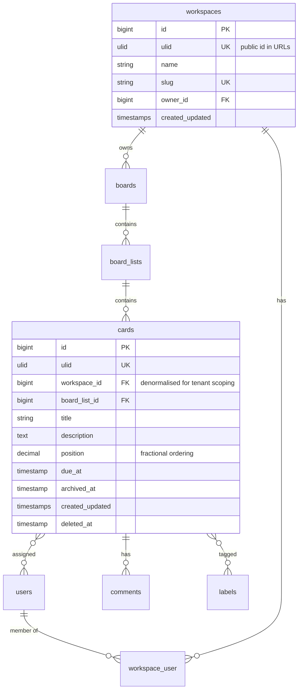

# Phase 0 — Product Blueprint & App Teardown

No application code in this phase. The output is a document the user approves.

## Blueprint template

Use this structure (save to `docs/blueprint.md` when a project directory exists):

```markdown
# <Product name> — Product Blueprint
_Status: DRAFT — awaiting approval · Date: <today> · Stack versions verified: <list>_

## 1. Vision & scope
- One-paragraph pitch, target users, the problem it solves.
- If a remake: what we keep from <original>, what we improve (from review complaints), what we drop.
- MVP definition: the smallest set of epics that makes it useful.

## 2. Personas & roles
| Role | Scope | Can… |
(e.g. Super admin (Filament), Workspace owner, Admin, Member, Guest/viewer)

## 3. Epics & features
### E1 <Epic name> — MVP
- User stories: "As a <role> I want <x> so that <y>" (3–8 per epic)
- Key workflows (numbered steps)
- Acceptance criteria (testable — these become Pest/browser tests)
### E2 …
(Mark each epic: MVP / v1.1 / Later)

## 4. Data model (ERD)
- Mermaid erDiagram
- Table notes: key columns, indexes, constraints, soft deletes, tenancy column
- DB choice (PostgreSQL / MariaDB) and why

## 5. Tech stack map
| Feature / concern | Tool | Why |

## 6. Architecture overview
- Contexts/modules, tenancy model, realtime, queues, storage, search

## 7. Non-functional requirements
- Performance targets, security, GDPR/AVG, accessibility (WCAG 2.2 AA), i18n, backups

## 8. Delivery plan
- Ordered milestones (foundation → epics in order), each demoable

## 9. Open decisions (need your input)
- Numbered questions with recommended answer

## 10. Sources
```

## Epic breakdown guidance

Every SaaS remake usually needs these foundation epics in addition to its domain epics — include them so they aren't forgotten:

- **Auth & onboarding** — register, login, email verification, password reset, 2FA, passkeys (Laravel 13), invite flow.
- **Workspaces/tenancy & team management** — create workspace, invite members, roles, switch workspace.
- **Billing** (if commercial) — Laravel Cashier (Stripe) or Mollie for NL/EU customers; plans mapped to feature limits.
- **Notifications** — in-app + email, user preferences.
- **Activity log / audit trail** — who changed what.
- **Search** — global search across main entities.
- **Admin (Filament)** — users, workspaces, plans, impersonation, metrics.
- **Settings & profile** — profile, password, appearance (dark mode), language, API tokens.

### Example: Trello remake domain epics

- E-Boards: create/archive boards, backgrounds, visibility (private/workspace/public), starring, templates.
- E-Lists & Cards (kanban): lists and cards with drag & drop reorder/move, card detail modal, description (rich text), due dates, labels, members, checklists, attachments, comments, cover image.
- E-Realtime collaboration: live updates of moves/edits via Reverb + Echo.
- E-Automation (later): rule-based triggers (Butler-like) via queued jobs.
- E-Views (later): calendar, table, timeline.

### Example: Teamleader remake domain epics

- E-CRM: companies, contacts, tags, custom fields, timeline.
- E-Deals: pipelines with phases (kanban), deal value, probability, won/lost.
- E-Quotations & Invoices: line items, VAT (BTW) rates, PDF generation, numbering per year, payment status, UBL/Peppol e-invoicing for Belgium/NL.
- E-Projects & Time tracking: projects, tasks, timers, billable hours → invoice.
- E-Calendar & Meetings.

## ERD conventions



Rules of thumb to state in the blueprint:

- `bigint` auto-increment PK internally + `ulid` unique column for public URLs (no enumerable IDs, still fast joins). Or `HasUlids` as PK when simpler.
- Every tenant-owned table carries `workspace_id` (even if derivable through a parent) so global scopes and indexes are cheap.
- Ordering columns (`position`) as `decimal(20,10)` or a string LexoRank — moving a card updates one row, not the whole list.
- Pivot tables get a composite unique index and their own timestamps if you'll ever display "added at".
- Money as integer cents (`bigint`) + `currency` char(3); never floats.
- Soft deletes only where users expect "restore" (cards, boards); otherwise hard delete + activity log.

## Tech stack map template

Example for an Inertia + React SaaS — swap rows according to `decision-matrix.md` (Livewire + Flux, Vue, API-only, no Filament, Mollie instead of Stripe…).

| Concern | Tool | Notes |
|---|---|---|
| Customer app UI | Inertia v3 + React 19 + TS + Tailwind v4 + shadcn/ui | SPA feel, server-side routing |
| Typed routes / actions in TS | Laravel Wayfinder | no hard-coded URLs in React |
| Admin / back-office | Filament v5 (`/admin`) | super-admins only |
| Roles per workspace | spatie/laravel-permission (teams) | `team_id` = `workspace_id` |
| Model authorization | Laravel Policies | combine with permissions |
| Uploads / attachments | spatie/laravel-medialibrary + S3/MinIO | conversions on queue |
| Drag & drop | `@dnd-kit/core` + `@dnd-kit/sortable` | optimistic updates via Inertia v3 |
| Rich text | Tiptap | sanitise HTML server-side |
| Realtime | Laravel Reverb + Echo (`@laravel/echo-react`) | private workspace channels |
| Queues | Redis + Horizon | media conversions, mail, webhooks |
| Search | Laravel Scout (database driver → Meilisearch/Typesense) | |
| Audit log | spatie/laravel-activitylog | |
| Tests | Pest 4+ (feature + browser), Larastan | |
| Deploy | Docker + Dokploy / Nginx Proxy Manager | |

End Phase 0 with: "Do you approve this blueprint, or what should change?" plus the open decisions list.
