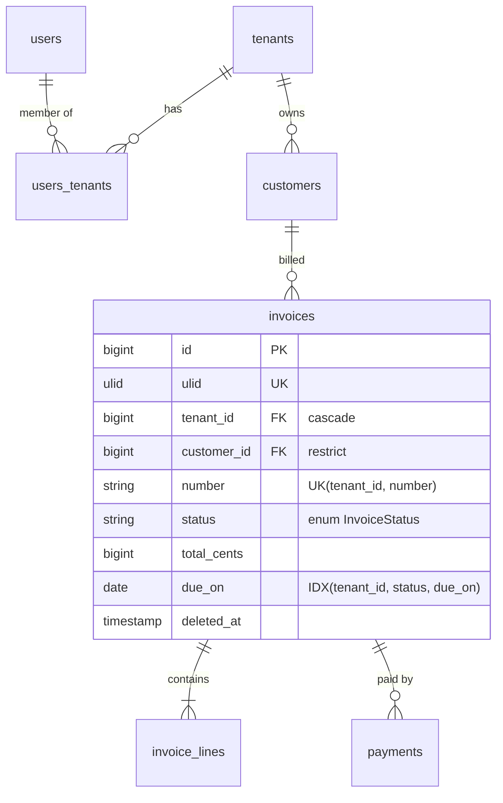

# Migrations (DB-01 … DB-07)

## Template

```php
<?php

declare(strict_types=1);

use Illuminate\Database\Migrations\Migration;
use Illuminate\Database\Schema\Blueprint;
use Illuminate\Support\Facades\Schema;

return new class extends Migration
{
    public function up(): void
    {
        Schema::create('invoices', function (Blueprint $table): void {
            $table->id();
            $table->ulid('ulid')->unique();
            $table->foreignId('tenant_id')->constrained()->cascadeOnDelete();
            $table->foreignId('customer_id')->constrained()->restrictOnDelete();   // legal record: block deletes
            $table->foreignId('created_by')->nullable()->constrained('users')->nullOnDelete();
            $table->string('number', 32);
            $table->string('status', 20)->default('draft')->comment('App\Enums\InvoiceStatus');
            $table->char('currency', 3)->default('EUR');
            $table->unsignedBigInteger('total_cents')->default(0);
            $table->date('issued_on');
            $table->date('due_on');
            $table->timestamp('sent_at')->nullable();
            $table->timestamp('paid_at')->nullable();
            $table->timestamps();
            $table->softDeletes();

            $table->unique(['tenant_id', 'number']);                 // business uniqueness
            $table->index(['tenant_id', 'status', 'due_on']);        // "overdue invoices" list
            $table->index(['customer_id', 'issued_on']);
        });
    }

    public function down(): void
    {
        Schema::dropIfExists('invoices');
    }
};
```

## Delete strategies (DB-01)

| Relation | Strategy |
|---|---|
| Owned child (lines of an invoice, cards of a list) | `cascadeOnDelete()` |
| Optional reference (assigned user, created_by) | `nullable()->nullOnDelete()` |
| Legal/financial/audit (invoice → customer, payment → invoice) | `restrictOnDelete()` + soft deletes or archiving |
| Polymorphic (`morphs`) | no FK possible — clean up in the Action/observer, index `(type, id)` |

## Indexing (DB-02)

- Composite index column order: equality filters first, then range/sort (`tenant_id, status, due_on`).
- Don't index low-cardinality booleans alone; include them in composites.
- Partial indexes (PostgreSQL) for soft deletes: `CREATE UNIQUE INDEX ... WHERE deleted_at IS NULL` via `DB::statement`.
- Full-text: `$table->fullText(['title', 'body'])` (MySQL/MariaDB/PG supported by Laravel).
- Check with `EXPLAIN` (`->explain()` on a builder) for the heaviest queries.

## Column guidance (DB-03)

| Data | Type |
|---|---|
| Money | `unsignedBigInteger('amount_cents')` + `char('currency', 3)` |
| Percentages / VAT | `decimal(5, 2)` or basis points as integer |
| Quantities | `decimal(12, 3)` |
| Status/type | `string(20)` + PHP enum cast (avoid DB `enum` — painful to alter) |
| Ordering (drag & drop) | `decimal(20, 10)` fractional index or string LexoRank |
| Settings blobs | `json` / `jsonb` with an `AsArrayObject`/DTO cast |
| IP addresses | `ipAddress()` |
| Email | `string(254)` (+ `citext` on PG for case-insensitive unique) |

## Zero-downtime changes (DB-05)

Expand/contract over releases:

1. **Expand** — add new nullable column/table; code writes both old and new.
2. **Backfill** — queued job with `chunkById()`; idempotent.
3. **Switch** — code reads new column.
4. **Contract** — next release: drop old column, add `NOT NULL`/constraints.

Never in one deploy: rename a column the old code reads, add `NOT NULL` without default to a big table, or create a big index without `CONCURRENTLY` (PG: `DB::statement('CREATE INDEX CONCURRENTLY ...')` with `public $withinTransaction = false;`).

## Squashing

`php artisan schema:dump --prune` once the migration count gets large (commit the schema file).

## ERD example


